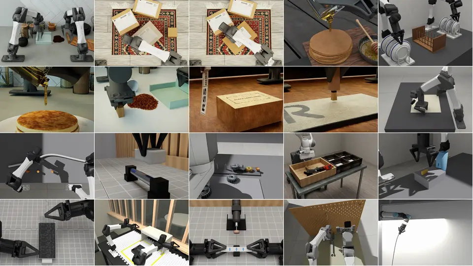

#  RoboSimStudio

[Tech report](https://arxiv.org/abs/2610.18835) | [Project Page](https://robosimstudio.github.io/) | [Examples](examples/README.md)

RoboSimStudio is an open, interactive GPU simulation toolkit for rebuilding real
robot manipulation tasks in simulation, by hand or with a coding agent.

<p align="center">
  
</p>

## News

- **2026/10/22** Real-to-sim with Codex: a coding agent works from
  [`examples/live/AGENTS.md`](examples/live/AGENTS.md), builds each twin in a
  folder of its own, and moves things only through the robot's fingers.
- **2026/10/21** Many demos at once, physics on the CPU and GL rendering: 500
  demos of 20 s, filmed by five 1280×720 cameras, in 4.2 min on one GPU
  (a plain MuJoCo + OpenGL setup takes 7.6 min).
- **2026/10/21** Fifteen kinds of material in `robosimstudio_materials`, each
  with a robot example in [`examples/03_materials`](examples/03_materials),
  among them rope, knots, paper, bags, brushes, tape, cutting, granular,
  liquid, dough and water, on Newton 1.7.
- **2026/10/18** CPU-only support: the `cpu` extra
  ([installation](examples/install.md)) runs with no GPU. An arm and a cube
  step at 9× real time, and a cable grasp at 1.4–1.6× (AMD EPYC 9555).
- **2026/10/14** First public release.

## Quick start

We provide an [installation guide](https://github.com/robosimstudio/robosimstudio/blob/main/examples/install.md) and comprehensive examples in [`examples/`](https://github.com/robosimstudio/robosimstudio/tree/main/examples) to help you get started quickly. Alternatively, you can use a coding agent such as Codex or Claude Code to create a simulation environment by simply providing the following prompt:

```
Set up environment for https://github.com/robosimstudio/robosimstudio
and create a simulation environment for [Your task instruction]
based on the video at [Your Video Path].
```

## Acknowledgements

RoboSimStudio is built on [Newton](https://github.com/newton-physics/newton),
[Warp](https://github.com/NVIDIA/warp) and
[MuJoCo Warp](https://github.com/google-deepmind/mujoco_warp), and its studio
on [viser](https://github.com/viser-project/viser). It draws on
[Isaac Lab](https://github.com/isaac-sim/IsaacLab),
[Isaac Lab Arena](https://github.com/isaac-sim/IsaacLab-Arena),
[PyRoKi](https://github.com/chungmin99/pyroki),
[Genesis](https://github.com/Genesis-Embodied-AI/Genesis),
[SuperDex](https://github.com/facebookresearch/project_superdex) and
[LeRobot](https://github.com/huggingface/lerobot). Robot models come from
[i2rt](https://github.com/i2rt-robotics/i2rt) and
[robosuite](https://github.com/ARISE-Initiative/robosuite); see `NOTICE`.
Thanks to their authors.

## Citation

```bibtex
@misc{robosimstudio2026,
  title         = {RoboSimStudio: An Interactive Toolkit for Rapid Real2Sim of Robot Manipulation Tasks},
  author        = {Chen, Kaiyuan and Xie, Shuangyu and Yoo, Uksang and Zhu, Xinyue and Magner, Cael and Zhu, Alvin and Kim, Daehwa and Heiden, Eric and Coumans, Erwin and Macklin, Miles and Huang, Spencer and Goldberg, Ken},
  year          = {2026},
  eprint        = {2610.18835},
  archivePrefix = {arXiv},
  url           = {https://arxiv.org/abs/2610.18835},
}
```

## License

RoboSimStudio is released under the [Apache License 2.0](LICENSE).
