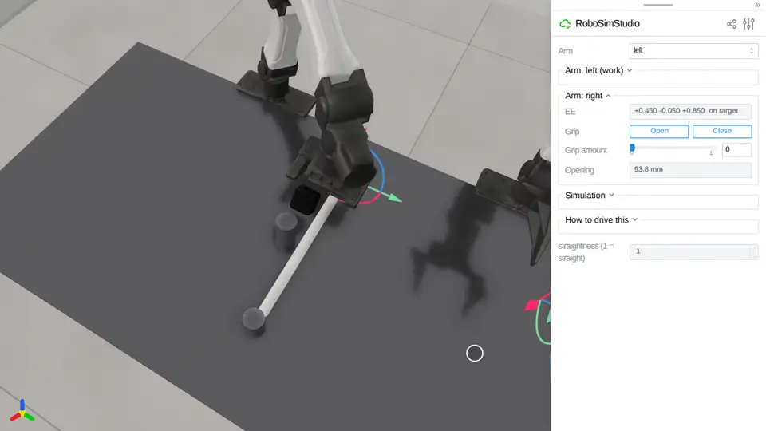
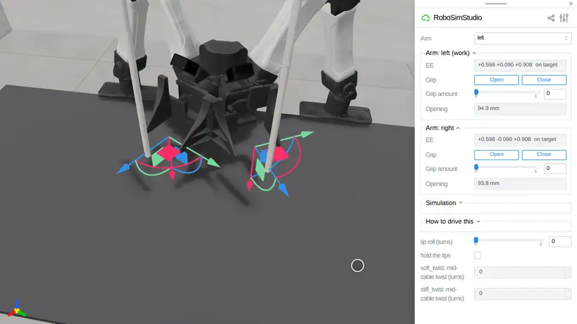

# Rope

Cables and ropes: a capsule chain on Newton by default, or a Cosserat rod on
SuperDex. [`robosimstudio_materials/rod/`](../../robosimstudio_materials/rod/) is
the implementation behind `rss.rod`; the
[route the cable](../08_demos/route_the_cable/README.md) demo uses it with two
YAM hands.

<!-- examples:start: written by scripts/example_readmes.py from each script's docstring -->

## Drag a cable


A cable lying on the bench under an open hand: drag the hand down onto it, close it and lift, or click any segment and drag it.

Drag the right hand down until the fingertips are just over the bench, press
**Close**, and lift slowly: friction alone holds the cable, which takes the
static friction `contact_matching="sticky"` supplies. Clicking a segment grabs
it instead, and `at` places the cable's first end, not its middle.

```bash
uv run examples/03_rope/00_cable.py
```

Source: [`00_cable.py`](00_cable.py)

## Cable between two posts


A cable clamped by both ends on top of two posts: drag the right hand down its arrow onto the cable's middle, press **Close**, drag it back up, press **Open**, and the cable springs back.

`anchors` holds each end's position, direction and twist where it was built:
one end clamped makes a cantilever, both make a span that sags under its own
weight (22 mm here). The cable is built 2 mm above the post tops so no contact
fights the clamps. The hand leans 40 degrees off straight down: pointing
straight down, a YAM's wrist cannot rise 30 mm off this span (`hook_reach`
probe, GPU 2). The jaws close on the 16 mm cable by contact (no latch); pulled
back 30 mm along the hand's axis, the middle rises 14 mm before the span, which
does not stretch, stops the hand; opened, it is back within 0.1 mm of where it
hung (`tests/test_cable_hook`, GPU 2).

```bash
uv run examples/03_rope/01_between_posts.py
```

Source: [`01_between_posts.py`](01_between_posts.py)

## Cable on SuperDex


The same cable stepped by another engine, a Cosserat rod on SuperDex: drag the right hand down onto it, slide **Grip amount** to 0.80 so the jaws close on it, and drag the hand up.

One entry in the arrangement routes the `rod` kind to SuperDex; the arms stay
on MuJoCo. The cable is one centerline with a twist at every node, stiffness from
`young_modulus`, contact on a tubular skin (its axis rests 11.2 mm up for an
11 mm radius). SuperDex drives the fingers as colliders by pose and its push on
them is not fed back: fed back, they closed through the cable at the default cap
and, uncapped, swung from -27 to +103 mm and squirted it out (`probe_a2`). So
**Close** shuts the jaws through it, to 0.0 mm; the cable still comes up 111 mm,
but riding on the shut fingertips inside its skin, not held between the pads
(`c_cable.py`). **Grip amount** 0.80 stops the blade tips at 19.2 mm on its 22,
the pads 0.1 mm into its skin. Nothing is pinned: the middle rises 113 mm and
slides 0.4 mm in the hand over 2 s, at 11 ms a control step
(`tests/test_superdex_cable_robot`, GPU 1). Needs `[superdex]`.

```bash
uv run --extra superdex examples/03_rope/02_superdex.py
```

Source: [`02_superdex.py`](02_superdex.py)

## A cable keeps its bend



A cable with plastic memory lies on the bench, clamped at its far end: drag the right hand down onto it, press **Close**, lift it a little, carry its end round the post while turning the gizmo's ring a third of a turn, lay it down, press **Open** and lift away, and it stays wrapped.

`dahl_eps_max` turns on Newton's Dahl bending hysteresis: a bend put into a
joint past `dahl_tau` radians is kept. The pads alone hold the cable (sticky
contacts, as in `00_cable`). Carried 120 degrees round the post and let go,
it reads straightness 0.69; built at 0, the same drive springs back to 0.99
(`tests/test_cable_robot`, GPU 2). The bench and posts have no friction, so
the bend is the cable's: with 0.24 or 0.024 left, the elastic cable stayed
wrapped too, 0.74 and 0.78 (`mem_drive` probe, GPU 2).

```bash
uv run examples/03_rope/03_cable_memory.py
```

Source: [`03_cable_memory.py`](03_cable_memory.py)

## A cable carries a twist



Two cables hang from a clamp, one twisting ten times more easily than it bends and one ten times less: drag each hand onto its cable's tip, press **Close**, turn each gizmo's ring a third of a turn about the cable and press **Open**, and the stiff one springs the turn back out while the soft one keeps it.

`twist_ke` splits Newton's rod joint from its bend. The pads alone hold each
tip, turned about the vertical. Turned 120 degrees, the soft cable takes 0.33
turns and the stiff 0.16, slipping in the jaws; opened, the stiff reads 0.000 in
30 steps, the soft 0.107 in 60 (`tests/test_cable_robot`, GPU 2).

```bash
uv run examples/03_rope/04_twist.py
```

Source: [`04_twist.py`](04_twist.py)

<!-- examples:end -->
