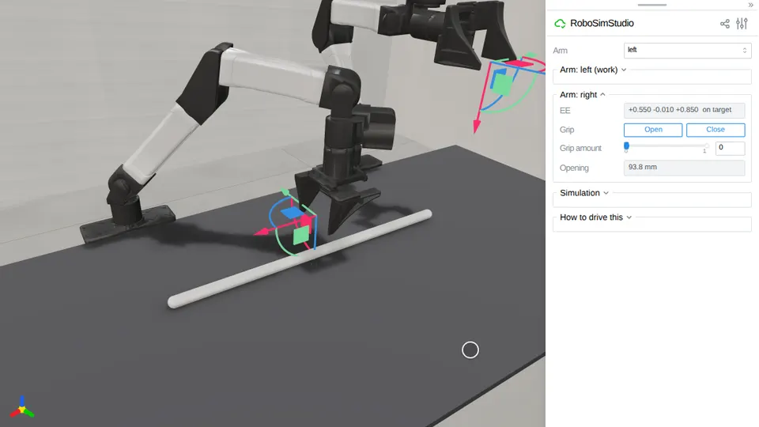
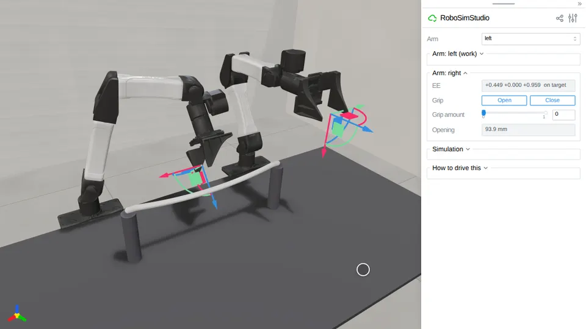
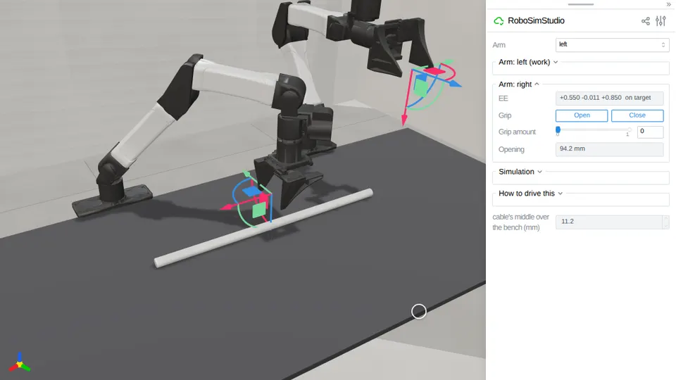

# Rope

Cables and ropes: a capsule chain on Newton by default, or a Cosserat rod on
SuperDex. [`robosimstudio_materials/rod/`](../../robosimstudio_materials/rod/) is
the implementation behind `rss.rod`; the
[route the cable](../08_demos/route_the_cable/README.md) demo uses it with two
YAM hands.

<!-- examples:start: written by scripts/example_readmes.py from each script's docstring -->

## Drag a cable



A cable lying on the bench under an open hand: drag the hand down onto it, close it and lift, or click any segment and drag it.

Drag the right hand down until the fingertips are just over the bench, press
**Close**, and lift slowly: friction alone holds the cable, which takes the
static friction `contact_matching="sticky"` supplies. Clicking a segment grabs
it instead, and `at` places the cable's first end, not its middle.

```bash
uv run examples/03_rope/00_cable.py
```

Source: [`00_cable.py`](00_cable.py)

## Cable between two posts



A cable clamped by both ends on top of two posts: hook it with a gripper or drag its middle, and it springs back.

`anchors` holds each end's position, direction and twist where it was built:
one end clamped makes a cantilever, both make a span that sags under its own
weight. The cable is built 2 mm above the post tops so no contact fights the
clamps.

```bash
uv run examples/03_rope/01_between_posts.py
```

Source: [`01_between_posts.py`](01_between_posts.py)

## Cable on SuperDex



The same cable spec stepped by another engine: a Cosserat rod on SuperDex, beside arms that stay on MuJoCo.

One entry in the physics arrangement routes the `rod` kind to SuperDex. The
cable becomes one centerline with a twist at every node, and its stiffness is
read from `young_modulus` instead of the capsule chain's stretch and bend
stiffness. Newton still holds its particles, so the page drags it the same way.
Needs the `[superdex]` extra (Python 3.12).

```bash
uv run --extra superdex examples/03_rope/02_superdex.py
```

Source: [`02_superdex.py`](02_superdex.py)

## A cable keeps its bend

The between-posts cable, clamped at one end only and given plastic memory: drag its free end round the far post and let go, and it stays wrapped.

`dahl_eps_max` turns on Newton's Dahl bending hysteresis for the capsule
chain: each cable joint carries a friction moment of `bend_ke * dahl_eps_max`
that builds up over `dahl_tau` radians of bending, so a bend put in past that
is held rather than sprung back. The same cable at 0 is elastic and springs
straight. The solver decides at construction whether to run the friction at
all, so the two plastic sliders in the cable's Parameters are live here and
inert on a cable built at 0. The page reads the cable's straightness: 1.0 is a
straight line, and what it reads after the hand lets go is what the cable kept.

```bash
uv run examples/03_rope/03_cable_memory.py
```

Source: [`03_cable_memory.py`](03_cable_memory.py)

## A cable carries a twist

Two cables hanging from a clamp, one twisting ten times more easily than it bends and one ten times less: roll a free end a turn and let go, and the stiff one springs the roll back out while the soft one keeps it.

`twist_ke` splits Newton's rod joint from its bend: left at `None` a cable
twists as stiffly as it bends, which is the isotropic pairing the builder
makes. A data cable's jacket rolls far more easily than it bends; a stranded
steel cable the other way round. The page reads each cable's `twist_turns`
over its middle third -- the roll between consecutive capsule frames with the
bend taken out, so a cable bent into a hook with no roll reads 0. Rolled a
full turn at the tip, both carry the same twist in the middle (a clamped cable
twists uniformly); let go, the stiff one unwinds in a fraction of a second and
the soft one over seconds, the time being `twist_kd / twist_ke`. They hang
because a level cantilever at this bend stiffness droops to the bench. Click a
capsule near a free end and drag its handle round to roll it.

```bash
uv run examples/03_rope/04_twist.py
```

Source: [`04_twist.py`](04_twist.py)

<!-- examples:end -->
