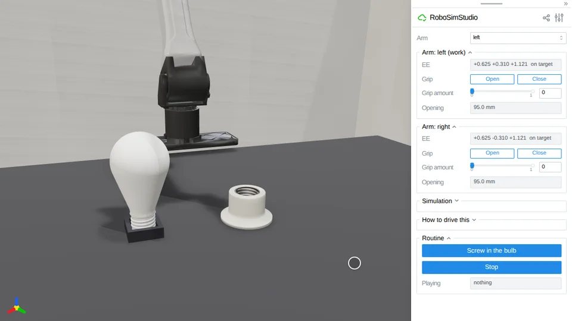

# Screw in the bulb



A YAM takes a household lamp from its tray, sets it in a lamp holder and screws
it in until the lamp's eyelet presses on the holder's centre contact, and the
lamp comes on.

```bash
uv run examples/08_demos/screw_in_the_bulb/screw_in_the_bulb.py
```

Press **Screw in the bulb** under *Routine*; **Reset** stands the lamp back in
its tray, dark.

## The scene

`rss.bulb` and `rss.socket` are the `thread` kind
([`robosimstudio_materials/thread.py`](../../../robosimstudio_materials/thread.py)),
cut to published numbers:

- **The lamp** is an A19 bulb on a medium Edison screw base (E26): 60.3 mm of
  glass at its widest, 111 mm tall, 32 g. The base is 23.8 mm tall and 26.3 mm
  over its thread, with a black insulator and a brass eyelet at its tip.
- **The thread** is the rounded one of the standard: seven turns to the inch
  (3.63 mm), 0.84 mm deep, its crest and root arcs of 1.19 mm. Base and holder
  are generated on one helix, 0.19 mm apart all round.
- **The holder** is a threaded metal shell in a porcelain body, with a centre
  contact in its floor. It stands on the bench 0.30 m in front of the left arm.
  **It is a fixture**: a lamp holder is screwed to something.
- **The tray** the lamp starts in, 120 mm to the side, is four low walls round
  its base. It is a fixture too.

Where each number comes from (the American Standard thread table, a GE base
data sheet, the A19's size) is in `LampSpec`'s docstring. The pear's outline
under its sphere and the holder's body are not from a drawing.

The physics is `rss.THREAD_60HZ`, as in
[`unscrew_the_cap`](../unscrew_the_cap/README.md).

## The routine

`routine(sim)` is a generator, one yield per control step, driving the left
arm's joints itself.

1. **Take the lamp.** The hand comes down over the glass, tool down, its
   `roll_axis` grip point 1.8 mm above the widest part, and closes in three
   stages: to 2.5 mm off the glass, onto it at 6 mm/s, then the squeeze. It
   lifts the lamp 50 mm out of the tray.
2. **Set it in.** The hand carries the lamp over the holder and lowers it into
   the mouth to 3.3 turns from home, 0.3 mm under where the thread's helix is
   at the lamp's turn. The two threads first meet at 3.25 turns, so the first
   stroke has the lamp caught within 18 degrees.
3. **Strokes.** The wrist turns 210 degrees clockwise in 2.5 s while the hand
   goes down with the thread, 2.1 mm. Then the jaws back 0.4 mm off the glass,
   the wrist turns back, and the jaws tighten. The hand never lets the lamp go
   until it is home: a lamp let go leans in its thread, and a hand that takes
   hold of it leaning turns it roughly.
4. **Stop on the contact.** Each control step of a stroke the routine reads the
   force between the eyelet and the centre contact from the scene's contact
   probe (`sim.contacts`). With under 0.15 turn to go by its own count, or the
   contact over 0.1 N, the wrist turns at a fifth of its speed; above 2 N it
   stops. That is two thirds of the way through the sixth stroke.
5. **Let go** and back off 60 mm.

The lamp is lit while that same force is over 0.1 N: `circuit(sim)` reads it
every control step and calls the lamp's `light()`, which repaints the glass.
The page adds a warm light of its own while the lamp is lit.

The routine reads the lamp's pose from the simulation, marked in the script, to
aim the hand and to set the lamp in on its helix (a person does that by feel:
turn it backwards until it drops). It writes none.

## Measured

Four plays of the routine with no page open, every reading taken each control
step:

| | play 1 | play 2 | play 3 | play 4 |
| --- | --- | --- | --- | --- |
| mm down per turn, strokes 2 to 6 (the pitch is 3.629) | 3.627 | 3.628 | 3.627 | 3.626 |
| most force on the centre contact | 2.2 N | 2.3 N | 2.2 N | 2.2 N |
| turns from home when the wrist stopped | 0.02 | 0.05 | 0.04 | 0.04 |
| seconds of scene | 41.2 | 40.1 | 40.4 | 40.1 |

Each play set the lamp in at 3.300 turns from home, took six strokes, ended
with the eyelet within 0.003 mm of the contact and 0.29 to 0.30 N on it (the
lamp weighs 0.31 N), leaning 0.1 degree or less, and lit the lamp as the eyelet
landed, 0.04 turn before home. Two more plays through
`tests/test_demo_screw_in_the_bulb.py` read 2.4 and 4.4 N at most on the
contact and left the lamp leaning 0.23 and 0.00 degrees.

- **On the thread.** While the wrist turns, the eyelet stays within 0.24 mm of
  where the helix puts it. The thread's own play is 0.18 mm either way, and the
  first stroke starts pressed 0.22 mm under.
- **Grip.** In every stroke the glass turned with the wrist to 0.1 degree, and
  the lamp leaned 0.34 degrees at most. On each turn back the loosened jaws
  drag the lamp back with them, 5 to 18 degrees.
- **Cost.** 1.0 x real time on an RTX PRO 6000; 423 to 429 contacts at the
  busiest step, of the 2048 the table allows.
- **The lamp alone**, turned by a torque with no robot
  (`tests/test_lamp_pair.py`): 3.62 mm a turn over two and a half turns, 0.2%
  under the pitch, and the contact stays closed with the torque gone; 1.6 x
  real time.

## Limits

- **Lit is a colour.** `light()` repaints the glass; the path tracer shows a
  lit lamp as tinted glass, not as a light source. The glow in the clip is a
  light the page adds.
- **The glass is drawn solid.** It is a closed pear, 149 cm³, weighted as a
  0.6 mm wall would be; frosted, so the path tracer does not show the
  difference much.
- **The centre contact is rigid.** A real holder's is a sprung tab.
- **Setting the lamp in uses its pose.** Set in on the helix with no press, one
  run in two rode the holder's first turn a millimetre high for a third of a
  turn before dropping in.
- **A lamp let go leans in its thread**, 0.2 to 0.7 degrees. With the jaws
  opened wide for each turn back, about one stroke in ten took hold of it
  leaning and slipped 3 to 20 degrees; with them 0.8 mm off, the turning hand
  knocked it over. 0.4 mm is what was measured to work.
- **Turned on at full speed, a round thread clamps hard.** Before the wrist
  slowed near home, one control step took the contact from under 2 N to between
  5 and 115 N.
- **The hand fits this bulb closely.** The palm is 2.3 mm above the glass when
  the jaws are on its widest part; a bulb wider than an A19 does not fit under
  it.
- **It needs a GPU**, as `rss.THREAD_60HZ` does.
