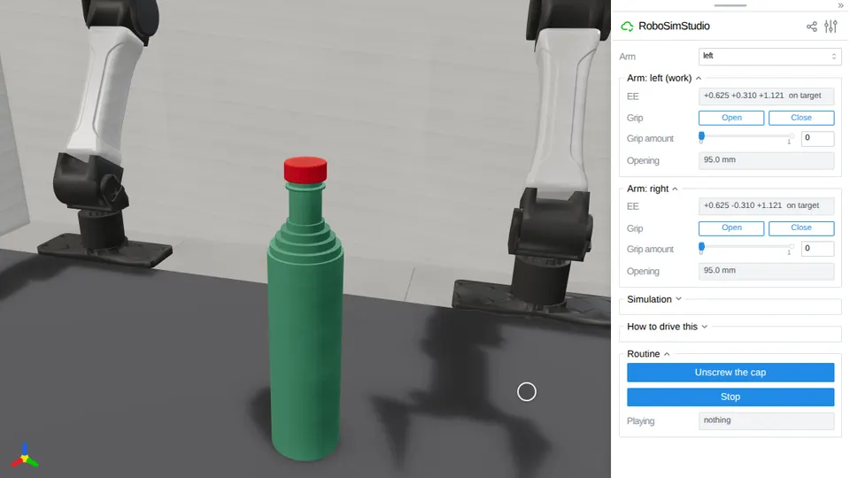

# Unscrew the cap



Two YAM arms open a bottle. The right hand holds it by its base, the left turns
the cap off its thread, and nothing joins the cap to the bottle but the contact
of the two threads.

```bash
uv run examples/08_demos/unscrew_the_cap/unscrew_the_cap.py
```

Press **Unscrew the cap** under *Routine*; **Reset** puts the cap back on.

## The scene

`rss.bottle` and `rss.cap` are the `thread` kind
([`robosimstudio_materials/thread.py`](../../../robosimstudio_materials/thread.py)):

- a 60 mm bottle 249 mm tall, 30 g, standing free on `bench_075` at
  `(-0.05, +0.10)`, where both arms reach it;
- a 2.9 g ribbed cap, 31.7 mm over its ribs, screwed home on a thread of 3 mm
  pitch wound two turns. Each part's thread is a mesh, a ridge 1.2 mm high, and
  the two collide through their signed-distance fields.

The physics is `rss.THREAD_60HZ`: the arms and both parts on one MuJoCo solver
at 1200 Hz, fed the contacts Newton's collision pipeline finds. MuJoCo's own
collision would make each mesh its convex hull, and a cap's hull is a solid
plug.

## The routine

`routine(sim)` is a generator, one yield per control step. It drives the arms'
joints itself, so the arm panels are held off while it plays.

1. **The right hand takes the bottle.** It comes in from its own side, 5 degrees
   nose down, to 28 mm over the bench, and closes its 50 N a jaw on the body.
2. **The left hand comes down over the cap**, tool down, with the hand's
   `roll_axis` grip point on the cap's axis. That point is where the fingertips
   cross the wrist's roll axis; the pads are 44 mm off it, and a cap held there
   would orbit the wrist.
3. **Four strokes.** The jaws close in two stages, the wrist turns 200 degrees
   counter-clockwise in 2.5 s with the arm's other five joints still, the jaws
   open, and the wrist turns back. Before each stroke the hand is re-aimed at
   the cap, which has risen.
4. **Lift.** The left hand carries the cap 40 mm up.

The routine reads two poses from the simulation, the bottle's and the cap's, to
aim the hands; each read is marked in the script. It writes none. It runs
32.6 s of simulated time.

## What holds the cap, and what moves it

Friction between the fingertips and the cap's ribs, 50 N a jaw, and nothing
else: no weld, no latch, no joint between cap and bottle. Nothing sends the left
hand upward during a stroke, so the cap's rise is the thread pushing it and the
hand with it, 1.4 to 1.6 mm a stroke.

## Measured

Three runs of the routine, two of them through
`tests/test_demo_unscrew_the_cap.py` and one by the clip's recorder:

| | cap turned on the bottle | cap over the rim at the end | bottle moved | bottle turned in the fingers | bottle leans |
| --- | --- | --- | --- | --- | --- |
| test run 1 | 2.222 turns | 32.9 mm | 1.6 mm | 7.2 deg | 0.2 deg |
| test run 2 | 2.226 turns | 32.9 mm | 1.4 mm | 6.0 deg | 0.2 deg |
| the clip | | 34.5 mm | 1.2 mm | | 0.1 deg |

While the threads are engaged the cap's height over the rim stays within the
thread's own play, 0.26 mm either way, of 3 mm times the turns made. In each
stroke the cap turns on the bottle within 12 degrees of the wrist's 200. After
three strokes, 1.67 turns, the cap is still on the helix; a lift there stalls
on the thread (measured on a clamped bottle). 259 to 262 contacts at the busiest
step, of the 2048 the table allows. 0.75 x real time on an RTX PRO 6000.

## Limits

- **The bottle is tall for a reason.** A hand holding the body near its base
  carries its wrist camera 180 mm over the bench, and the other hand's pads
  hang 56 mm below the rim. On a 199 mm bottle the two met (100 N between the
  arms), so the bottle is 249 mm.
- **The bottle turns in the right hand's fingers**, 6 to 7 degrees over the
  job: two line contacts 12 mm long on a round body.
- **Close slowly.** A jaw that arrives at 85 mm/s knocks a 3 g cap up inside
  its thread's play; the routine stops 2.5 mm off the cap and closes from there.
- **It needs a GPU**, as `rss.THREAD_60HZ` does.
