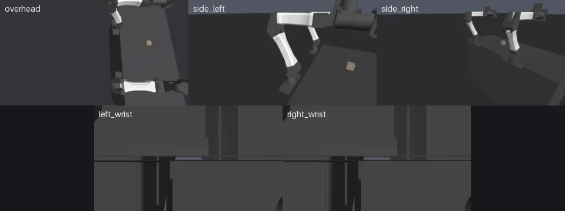

# Datasets

Many scripted demos at once, filmed by a fixed rig and written to the episode
store, for training a policy on.

<!-- examples:start: written by scripts/example_readmes.py from each script's docstring -->

## Many demos



Film scripted bimanual YAM demos in parallel: five 1280x720 cameras at 20 Hz.

`collect` starts worker processes that each build the scene once and run
their share of the episodes. Each worker steps the physics on a CPU core
(MuJoCo's C library, one call per control period), rasterises the cameras with
the `gl` renderer on a GPU, and encodes each camera in its own `ffmpeg`
while the next period steps. A 20 s demo takes about two seconds in one worker.

`make_policy` gets the episode number after each reset and returns `act`,
which gives one `joint_position` action per control step. This one reaches
the right arm out and back, a little differently every episode, and solves
nothing: it is where your scripted demo goes. Each episode lands in
`outputs/many_demos/<episode>/`, with `cameras/<name>.mp4`, the actions and
joint positions in `steps.npz`, and the body poses at every step in
`privileged.npz`. For hundreds, `python -m robosimstudio.record.collect`
runs the same two references from the shell; this folder's README has the line.

```bash
uv run examples/10_datasets/00_many_demos.py
```

Source: [`00_many_demos.py`](00_many_demos.py)

<!-- examples:end -->

## Five hundred demos

The same scene and policy, named by path, from the shell. Episodes already on
disk are skipped, so a stopped run picks up where it was:

```bash
uv run python -m robosimstudio.record.collect \
    --scene examples/10_datasets/00_many_demos.py:build \
    --policy examples/10_datasets/00_many_demos.py:make_policy \
    --episodes 500 --out outputs/many_demos
```

`--workers` defaults to one per six cores and `--gpus` to every GPU visible;
`--device cuda` steps on the GPUs instead, and `--renderer tiled` draws a scene
the `gl` renderer refuses, one with cloth, rope or soft bodies.
