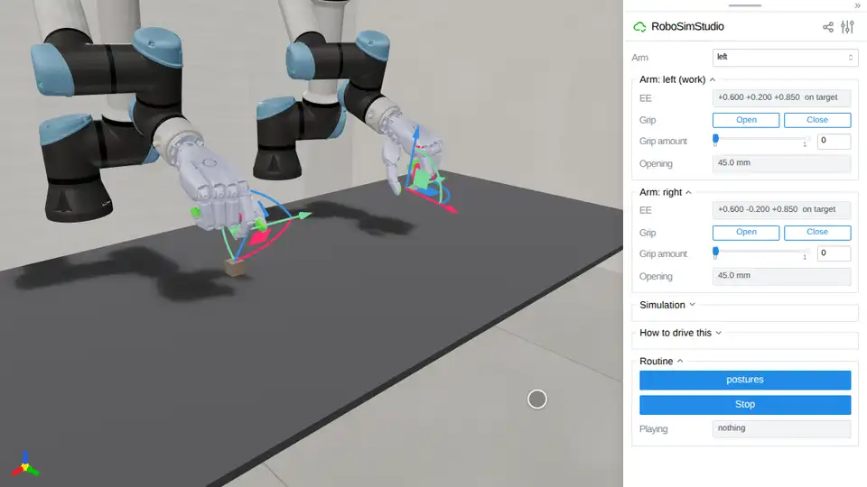

# Dexterous hands

A five-finger hand on an arm, driven the two ways the library drives a hand:
the scalar grip every jaw has, which on the Sharpa Wave closes into a
thumb-index pinch, and a posture written joint by joint, which is what a fist,
a pointing finger or a retargeted human hand needs.

<!-- examples:start: written by scripts/example_readmes.py from each script's docstring -->

## Sharpa Wave hands



Two UR5e arms wearing Sharpa Wave hands, 22 joints each: the studio's **Close** makes a thumb-index pinch, and a routine plays the other postures.

`ur5e_sharpa_bimanual` is a catalog robot like any other: drag a hand's gizmo
down onto the cube, press **Close** and lift, and the pinch holds it by friction
(`rss.MUJOCO_500HZ` puts the hands and the cube in one engine). What a jaw
cannot say goes through the hand's named postures: **Run** cycles the left hand
through a fist, a pointing finger and the pinch while the right hand waits, each
posture written joint by joint with `gripper.set_joint_targets`. The hand's
joints, gains and postures: `robosimstudio/robots/grippers/sharpa_wave.py`.

```bash
uv run examples/10_hands/00_sharpa_wave.py
```

Source: [`00_sharpa_wave.py`](00_sharpa_wave.py)

<!-- examples:end -->

## The hand

| Thing | Where |
| --- | --- |
| The hand's joints, gains, postures and measured pinch | `robosimstudio/robots/grippers/sharpa_wave.py` |
| The arms it ships on, `ur5e_sharpa` and `ur5e_sharpa_bimanual` | `robosimstudio/robots/embodiments/ur5e_sharpa.py` |
| The vendored files, their licences and what was measured on them | `assets/embodiments/sharpa_wave/`, `assets/embodiments/ur5e/`, `assets/PROVENANCE.md` |
| How the composed files are made | `scripts/compose_ur5e_sharpa.py` |

A posture is a tuple of 22 joint angles in the hand's own order;
`sharpa_wave.posture(thumb_CMC_FE=1.1, index_PIP=0.9)` writes one by name. A
hand plays it with `sim.gripper("left").set_joint_targets(values)`, and
`set_joint_targets(None)` hands the fingers back to the grip slider.
