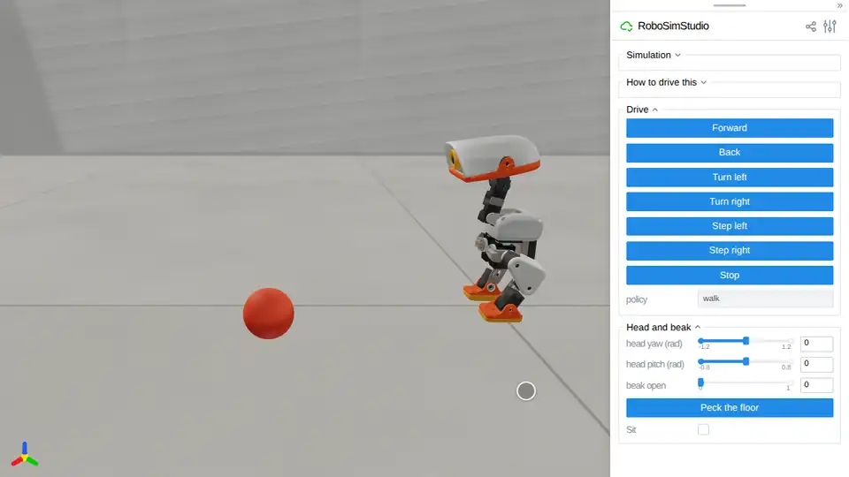
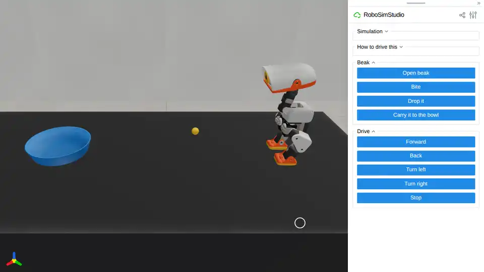
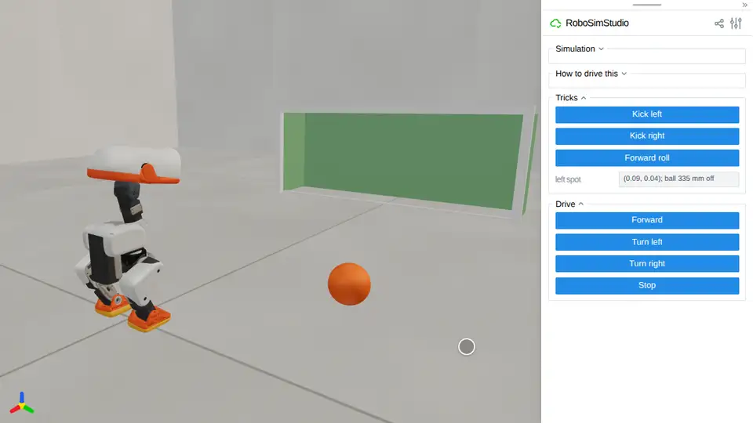
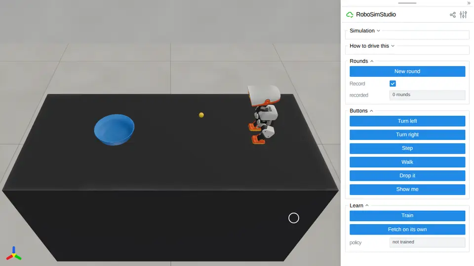

# Microduck

[Microduck](https://github.com/pollen-robotics/microduck) is Pollen Robotics'
open-source walking duck: 25 cm, 800 g, fifteen XL330 servos and a beak that
grips. Here it stands in the lab on its own walking policy -- the one it runs
on the real robot -- and you drive it, pick it up, feed it, and teach it an
errand from a few clicks.

<!-- examples:start: written by scripts/example_readmes.py from each script's docstring -->

## Walk the duck



The Microduck on the lab floor, on its own walking policy: drive it from the page, turn its head, pick it up with the mouse.

The robot is Pollen Robotics' open-source biped on a free joint, its fifteen
servos position-controlled with the gains fitted to its XL330s, and once per
control step it runs the policy it walks with on the real robot -- the official
`velstand` network, trained in MuJoCo Warp at 50 Hz. Nothing holds it up but
its feet. Click any part of it and drag: it hangs from the handle, kicks, and
finds its feet again when you put it down. Needs the `[microduck]` extra, for
its ONNX policies; the robot and the policies are downloaded on first run.

```bash
uv run --extra microduck examples/10_microduck/00_walk.py
```

Source: [`00_walk.py`](00_walk.py)

## Fetch a ball



The duck on the lab bench, a ball and a bowl: feed it the ball with the mouse, and it carries it over and drops it in.

Press **Open beak**, click the ball and drag its handle up into the open
beak, press **Bite** and **Release all**: the ball is held by the beak's
two pads and nothing else. Then drive it to the bowl with the buttons and
press **Drop it**, or press **Carry it to the bowl** and it steers there
itself, stopping short of the rim. Dropping is what a duck does: beak open,
head tipped down, and the ball rolls out over the lip. Needs `[microduck]`.

```bash
uv run --extra microduck examples/10_microduck/01_fetch.py
```

Source: [`01_fetch.py`](01_fetch.py)

## Penalty kick



A ball, a spot and a goal on the lab floor: put the ball down in front of a foot with the mouse, and the duck kicks it in.

The kick is one of Pollen's own one-shot policies, trained blind to the ball:
it expects the ball 90 mm ahead of the trunk and 42 mm out to the kicking
side, swings, and stands back up on its own. So the aim is yours: click the
ball, drag its handle onto the spot in front of the left foot, **Release
all**, and press **Kick left**. **Forward roll** is another of its tricks.
Needs `[microduck]`.

```bash
uv run --extra microduck examples/10_microduck/02_kick.py
```

Source: [`02_kick.py`](02_kick.py)

## Learn to fetch



Click the duck to the bowl a few times, press Train, and it fetches on its own: behaviour cloning on your button presses.

**New round** resets the scene, moves the bowl and puts the ball in the beak.
Bring the duck over with **Turn left**, **Turn right** (15 degrees), **Step**
(a few centimetres) and **Walk** (about 15 cm), and press **Drop it** with the
beak over the bowl. Each press is kept with where the bowl was from the beak;
**Train** fits a small classifier to them (`learn.py`) and **Fetch on its
own** lets it press the buttons. Three to six rounds are enough, and **Show
me** lets a scripted helper do one. Needs `[microduck]`.

```bash
uv run --extra microduck examples/10_microduck/03_learn_to_fetch.py
```

Source: [`03_learn_to_fetch.py`](03_learn_to_fetch.py)

<!-- examples:end -->

## How the duck is put together

`duck.py` is the duck as a kind of thing, written the way
[`04_extending/01_new_kind.py`](../04_extending/01_new_kind.py) writes one:

- **The robot** is Pollen's MJCF (`robot_groundcontact.xml` from
  [`microduck_rl`](https://github.com/pollen-robotics/microduck_rl)) on a free
  joint: nothing holds it up but its feet. Its servos keep the gains, force
  limits, friction and armature fitted to the real XL330s.
- **The brain** runs once per control step, in the entity's `before` hook: it
  reads the IMU and the joints off the state, builds the 61-float observation
  every official policy shares, and writes fifteen servo targets. The policies
  are the official set
  ([`pollen-robotics/microduck-policies`](https://huggingface.co/pollen-robotics/microduck-policies),
  tag `v8`): `velstand` walks and stands, `alpha_ground_pick` pecks the floor,
  `ball_kick_*` kick and `roulade` rolls.
- **The physics** is `DUCK_200HZ`: MuJoCo at 5 ms, 50 Hz control, what the
  policies were trained at. On a flat floor a 0.3 m/s command walks at about
  0.14 m/s, as it does in Pollen's own CPU MuJoCo rehearsal (0.11 there).
- **The beak** is added by `assets.py`. The official model has fourteen servos;
  the real robot's fifteenth opens the beak (-5 deg shut, +30 deg open) and no
  policy drives it. The lower beak becomes a body on a hinge through the mouth
  servo's horn, and both halves get a flat, grippy pad, with a shallow groove
  and a lip so a held ball stays put.

What it can and cannot do, measured: it walks, turns, stands back up after a
drop and kicks a ball four metres. It holds a 24 mm ball through walking and
turning. It cannot pick a ball off a table on its own: the official ground pick
stops its beak 20 mm above the surface (in Pollen's CPU MuJoCo too), and its
beak reaches only about as far as its toes, so it drops things into wide, low
containers, not onto the middle of a plate.

## Learning to fetch, measured

`learn.py` is the whole of the learning: a three-number observation (where the
bowl is from the beak, in the duck's frame), five buttons, and a 3-64-64-5 MLP
classifier fitted to the presses. Fitted to rounds demonstrated by the careful
person's rule in `learn.teacher` and scored on twelve fresh bowl placements
anywhere on the bench -- ahead of the duck, beside it or behind it -- where a
round counts when the ball ends in the bowl and the duck is still standing:

| Demonstrated rounds | 1 | 3 | 6 | 12 |
|---|---|---|---|---|
| Learned policy, rounds won | 3/12 | 9/12 | 11/12 | 11/12 |

The rule itself wins 19 of the 22 rounds it demonstrated. Two things it took to
get here: the policy learns button presses, not speeds and turn rates -- a
person's clicks are moves that finish by themselves, and cloning the speed
instead copies the stand-still while the cursor travels to the next button,
which lands inside the gait's dead zone, where it stops -- and it drops once the
beak is 90 mm from the bowl's middle, since closer than that its toes are on
the rim and it trips in.

## The robot's files

Nothing of the robot is in this repository. `assets.py` downloads the MJCF and
its meshes from `pollen-robotics/microduck_rl` at a pinned commit, and the
policies from the Hub at tag `v8`, into `~/.cache/robosimstudio/microduck/`
(`MICRODUCK_CACHE` moves it). The code and the policies are Apache-2.0; the
meshes are [CC BY-NC-SA 4.0](https://creativecommons.org/licenses/by-nc-sa/4.0/).
