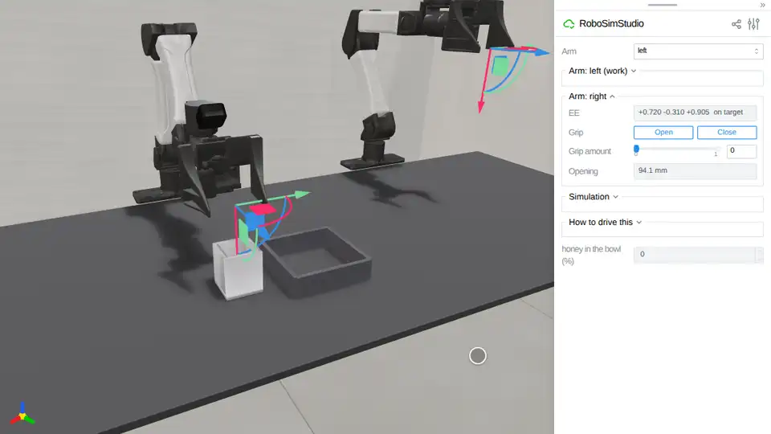

# Liquid

Honey, ketchup and water: a pool of particles on Newton's implicit MPM, poured
from a cup or pushed by a wiper.
[`robosimstudio_materials/liquid.py`](../../robosimstudio_materials/liquid.py)
is the kind behind `rss.liquid`; its docstring states the two Newton 1.6
caveats these examples are built around (the water preset loses volume; thin
walls leak without a margin), and the shared implementation is
[`robosimstudio_materials/mpm/`](../../robosimstudio_materials/mpm/).

<!-- examples:start: written by scripts/example_readmes.py from each script's docstring -->

## Pour honey into a bowl



A cup of honey under the right hand and a bowl beside it: drag the hand down until its open jaws straddle the cup, close on it, drag it up and across over the bowl, then turn the gizmo 40 degrees about the vertical and 140 degrees about the axis pointing away from the robot.

The jaws open 94 mm and the cup is 66 mm across, so they close on its outside walls; it is a rigid body on
the arm's island (`rss.LIQUID_120HZ`), held by friction, its 8 mm walls named in the honey's `containers`
for the margin a liquid needs. The arm sags about 30 mm under 0.48 kg of cup and honey: lift the gizmo
150 mm over the bench to clear the bowl's 40 mm walls. The wrist's last joint stops at 120 degrees, and a
roll alone tipped the cup 117: the honey crept along the wall and 17% was in the bowl after 12 s held
(`robot_pour`, GPU 1). The turn about the vertical first lets the arm reach 140, where the honey leaves
the cup in one mass within a second: 99% or more in the bowl, 0 to 8 of the 8,000 particles through the
bench where it lands, the cup 7 mm along the pads (`tests/test_pour_honey`, GPU 1, RTX PRO 6000). Honey,
because Newton 1.6's water preset loses volume (`robosimstudio_materials.liquid`). The panel counts the
honey in the bowl. 29.8 ms per control step, graph-captured.

```bash
uv run examples/11_liquid/00_pour_honey.py
```

Source: [`00_pour_honey.py`](00_pour_honey.py)

## Wipe a spill

A ketchup puddle in front of the right hand and a rubber-faced wiper standing under it: drag the hand down onto the wiper, close on it, and push the puddle toward the middle of the bench.

Ketchup is a Bingham fluid here (a 300 Pa yield stress, viscosity 100), so the
puddle holds its edge until the wiper moves it. The hand starts over the wiper
pointing down, its tool centre 100 mm over the bench and 85 mm over the wiper's
centre, its jaws across the wiper's 20 mm faces, so the pads cover the wiper's
whole height and the push cannot tip it: the same wiper on the
page's drag handle, which holds a body's tilt with a soft spring, pitched over
under the puddle's resistance and rode across it, moving 22-51% of a 12 mm
puddle off its patch in three identical runs; held by the hand it moved 96-98%
of that puddle in three, and 98% of this 6 mm one (`wipe_probe` and
`session_wipe`, RTX PRO 6000, Newton 1.6.0). The panel counts the
ketchup that has left the patch it settled on, at any height, because the
wiper piles it into a ridge, and reads the ridge's height. The puddle is only
pushed, never dropped, so it would hold at 60 Hz; it runs on the one liquid
table, `rss.LIQUID_120HZ`, at 25.9 ms per control step, graph-captured.

```bash
uv run examples/11_liquid/01_wipe_spill.py
```

Source: [`01_wipe_spill.py`](01_wipe_spill.py)

<!-- examples:end -->
