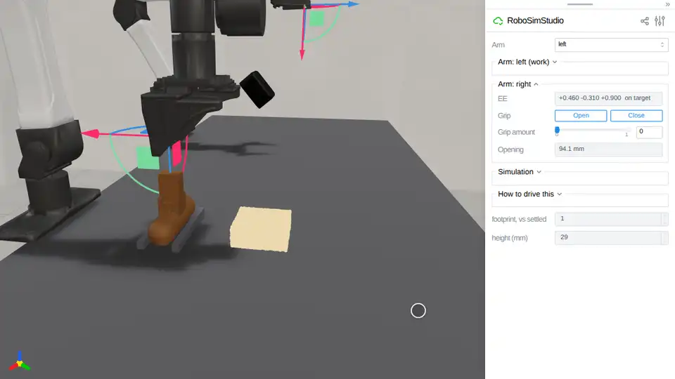
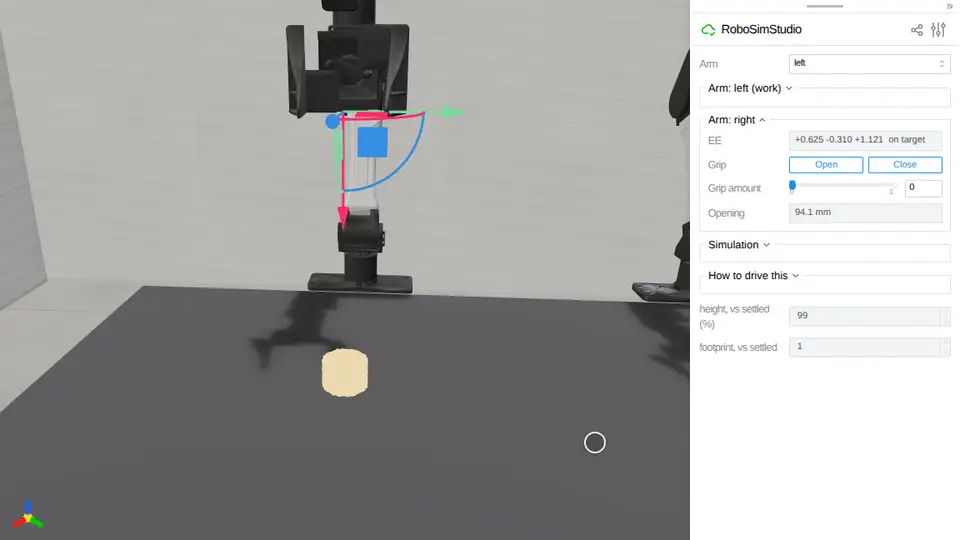

# Dough

Dough, plasticine, clay and butter: a plastic solid on Newton's implicit MPM
that keeps what a rolling pin or a gripper does to it.
[`robosimstudio_materials/dough.py`](../../robosimstudio_materials/dough.py)
is the kind behind `rss.dough`; the shared implementation is
[`robosimstudio_materials/mpm/`](../../robosimstudio_materials/mpm/).

<!-- examples:start: written by scripts/example_readmes.py from each script's docstring -->

## Roll the dough flat



A block of dough and a roller standing in its rest beside it, the right hand pointing down over the roller's handle: drag the hand down onto the handle, close on it, lift the roller out of its rest, lower it onto the near edge of the block and roll it across, back and across again.

Dough here is a plastic solid with a 1 kPa yield stress: it keeps what the
roller does to it. The roller (`rss.roller`) is a 40 mm drum on an axle under
a handle the jaws close across, a small articulation on the robot's island
(`rss.DOUGH_60HZ`). The grip alone would not hold it down (a plain handle slid
30 mm up through the jaws in one pass), so the handle's shape carries the load:
a shoulder under the fingertips takes the dough's push, a wall either side of
each finger takes the drag. Three passes at 0.1 m/s, the drum's underside about
11 mm over the bench, take the block from 28.6 to 12.6 mm and its footprint to
about twice the settled one (2.01 to 2.11 in three drives on Newton 1.7, where
1.6 read 1.75), the drum turning 4.2 to 4.6 rad a pass; welded to its handle it
slid and left 18.6 mm on 1.6 (`probe_roll2`). The panel reads the footprint
against the settled one and the height at the 95th percentile of the particles.
21.8 ms per control step on an RTX PRO 6000, graph-captured
(`tests/test_roll_dough`, GPU 3).

```bash
uv run examples/12_dough/00_roll_dough.py
```

Source: [`00_roll_dough.py`](00_roll_dough.py)

## Press a dough ball



A puck of dough under the right hand: close the gripper, drag the hand down into the dough and lift it away again.

What a plastic solid keeps is the measure: the press probe behind the `dough`
preset kept 83% of a 15 mm compression after the plate lifted (plasticine 75%,
clay 66%). The panel reads the puck's height as a share of the height it
settled at, and its footprint against the settled one: the closed hand driven
15 mm under the top through the arm panel and lifted away leaves 76% under
the hand and 76% after (`tests/test_press_dough`, GPU 0). Change `material` to
`"plasticine"` or `"clay"` for a stiffer lump. 23.4 ms per control step on
an RTX PRO 6000, graph-captured.

```bash
uv run examples/12_dough/01_press_dough.py
```

Source: [`01_press_dough.py`](01_press_dough.py)

<!-- examples:end -->
