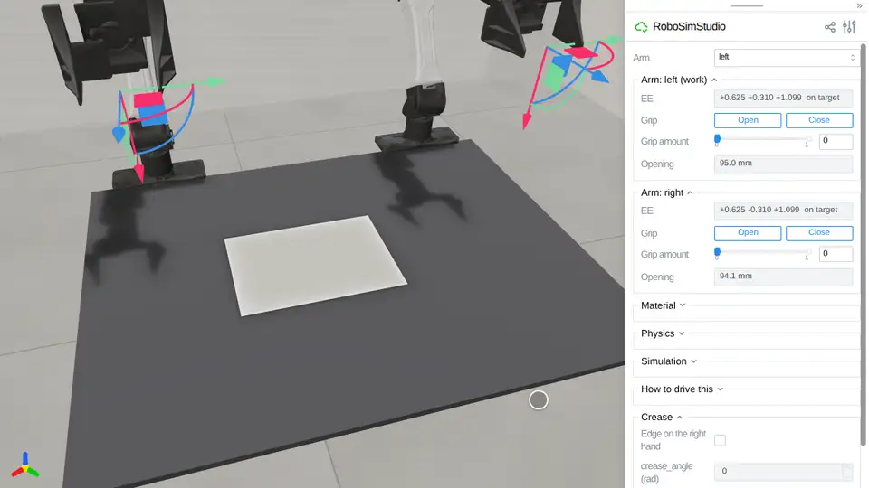
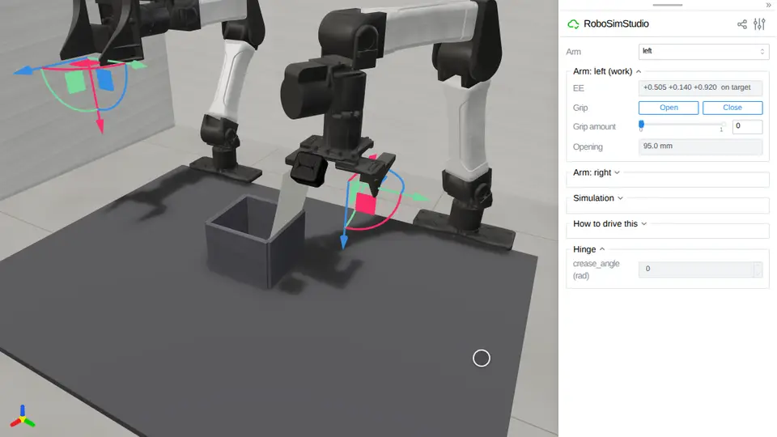

# Paper

A sheet whose folds stay.
[`robosimstudio_materials/paper.py`](../../robosimstudio_materials/paper.py) is the
implementation behind `rss.paper`: cloth with a bending hinge that yields, so a
fold pressed past the yield angle is kept and a gentle curl springs back. Two
materials ship, `rss.papers.PAPER` (80 g/m² copy paper) and `rss.papers.CARDBOARD`
(folding carton board); `crease_angle` reads how far a sheet stays turned
through a line.

<!-- examples:start: written by scripts/example_readmes.py from each script's docstring -->

## Fold a sheet of paper



An A4 sheet hangs 35 mm over the bench's right edge: close the left hand and press the far end down, drag the right hand down and in so its jaws straddle the overhanging corner, press **Close**, carry the edge up and over while turning the hand over, lay it on the middle and draw it on and up 3 cm, stamp the fold with the left hand, set the right hand's **Grip amount** to 0.5 and draw it out past the edge: the sheet stays folded in thirds.

The pads hold the paper by friction alone, and the fold keeps 2.53 to 2.67 rad over 18 drives
(`tests/test_fold_paper_robot`, its take, Newton 1.7). The overhang is what makes the pinch possible:
a sheet lying flat gives the lower pad nothing to get under (seven top-down pinches raised it 0 mm), and
the palm stops the jaws at the corner. The three stamps also shove the folded sheet 46 to 47 mm along
the bench, away from the edge, and the fold rides with it (`tests/test_fold_paper_robot`, two drives).
The stamps need the edge still held and lifted clear: let go first and the stamped fold kept 1.0 rad;
held 3 mm over the sheet, the stamps pushed it into the lower finger and the leaving hand dragged it 94
to 108 mm (`fold_contact.py`, GPUs 3 and 5). The **Crease** folder reads `crease_angle` and
`fold_extent`; set `yield_angle` to 0 under **Material** and the same fold springs open.

```bash
uv run examples/13_paper/00_fold_paper.py
```

Source: [`00_fold_paper.py`](00_fold_paper.py)

## Close a cardboard flap



A carton-board flap standing open on the rim of a box and the left hand pointing down beside it: press **Close**, drag the hand toward the box to push the flap over, down to press it into the box, and up again, and it stays shut.

The box is four slabs; the flap is a strip of CARDBOARD `pinned` on the far rim, standing up and leaning out
15 degrees as an opened carton's does, because a hand cannot lift one lying out level: the YAM's closed fingers
stand 100 mm over their tips, the height of the box. Pushed over and pressed 55 mm out from the hinge until its
free edge is 74 mm under the rim, the hinge rows bend past the yield and keep 1.9 rad, so the flap comes back
level when the hand lifts (5 mm under, `flapdrive.py`, GPU 7, RTX PRO 6000). Pressed to the same depth 75 mm
out, the board bends along its length instead: the hinge keeps 1.6 rad and the flap springs back to 13 degrees
over level, its edge 30 mm over the rim (two drives, `fixprobe.py`, GPUs 1 and 6). Board this stiff needs VBD
at 20 iterations instead of 5 (on the drape bench a 100 mm flap sags 19 % of its length at 5 and 5 % at 20),
40 ms per control step. The **Hinge** readout is `crease_angle`.

```bash
uv run examples/13_paper/01_box_flap.py
```

Source: [`01_box_flap.py`](01_box_flap.py)

<!-- examples:end -->
