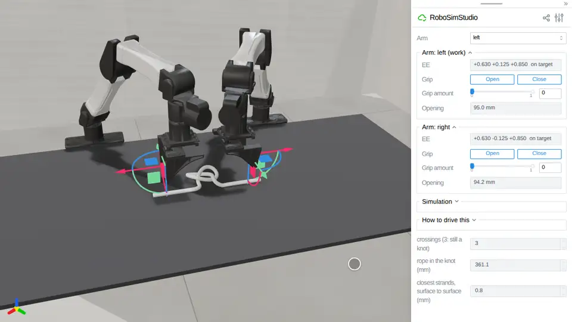

# Knots

A rope crossing itself, held apart where it crosses by its own contact.
[`robosimstudio_materials/rod/knot.py`](../../robosimstudio_materials/rod/knot.py)
lays a loose overhand knot's nodes on the bench (`overhand`) and reads what a knot
is: how many times the rope crosses itself seen from above (`crossings`, also an
atom), how much rope the knot ties up (`knot_length`), and how close two strands
come, surface to surface (`self_clearance`). `RodSpec.self_contact` is what keeps a
knot a knot: SuperDex then tests the rope's skin against itself, and without it a
pulled knot comes undone through itself. Needs the `[superdex]` extra (Python 3.12).

<!-- examples:start: written by scripts/example_readmes.py from each script's docstring -->

## Pull a knot tight



A loose overhand knot in a rope lies on the bench between the two hands: drag each hand down onto its tail, slide its **Grip amount** to 0.90, drag both hands up 120 mm, then each out 85 mm, and the knot draws up and stays a knot.

A knot is a rope crossing itself, held apart where it crosses by its own contact
(`self_contact`: SuperDex tests the rope's skin against itself). The pads hold the
tails by friction, nothing pinned. Pulled to 490 mm across, the knot gives back 59
of its 361 mm of rope and keeps its three crossings, the closest strands 0.29 mm
into each other on any step (`k_knot.py`); with self-contact off one strand goes
straight through another, a whole 12 mm, and one crossing is left
(`tests/test_knot_pull`, GPU 1). BDF2 drew it to 239 mm but let a tail slide 88 mm
through a hand (`probe_c3`). 20 to 45 ms a control step. Needs `[superdex]`.

```bash
uv run --extra superdex examples/17_knots/00_pull_knot_tight.py
```

Source: [`00_pull_knot_tight.py`](00_pull_knot_tight.py)

<!-- examples:end -->
