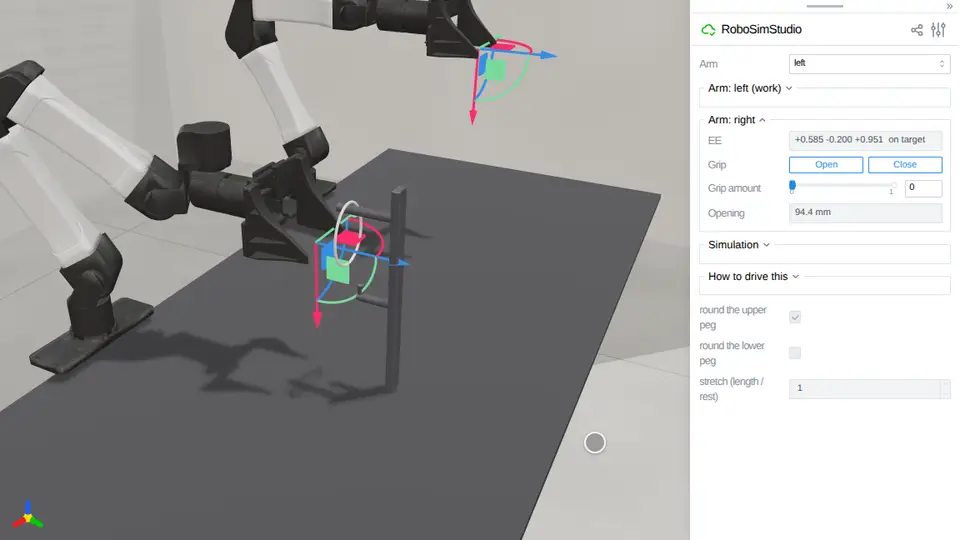

# Bands

A rod closed into a loop: a rubber band, an O-ring.
[`robosimstudio_materials/rod/band.py`](../../robosimstudio_materials/rod/band.py) is
the implementation: `band(...)` lays a `RodSpec(closed=True)` round a circle, flat on
the bench or standing in the plane a peg hangs it in, and SuperDex steps it as a
Cosserat rod whose last node joins its first. Two materials ship, `RUBBER` (a 4 mm
natural-rubber band, 1.5 MPa) and `O_RING` (a 5 mm nitrile cord, 8 MPa); `loop_winding`
counts how many times a loop goes round an axis, and the `encircles` atom says
whether it is round a peg. Needs the `[superdex]` extra (Python 3.12): the capsule
chain has two ends and refuses a closed rod.

<!-- examples:start: written by scripts/example_readmes.py from each script's docstring -->

## Hook a band on pegs



A rubber band hangs on the upper peg of a pegboard: press **Close** and drag the right hand's shut jaws into the loop, down past the lower peg, in toward the board under it, up, and back out, and the band stays stretched round both pegs.

A band is a closed rod (`RodSpec.closed`): SuperDex closes its polyline with an
element from the last node back to the first, so it has no ends (the capsule chain
refuses one). The shut jaws carry it by contact alone; nothing is pinned. It ends
round both pegs about 19% longer than at rest, held by the pegs; the same cord cut,
driven the same way, is left on the upper peg at its rest length, so what keeps it
is the loop (`tests/test_band_on_pegs`, GPU 1). Backing out, the jaws drag the
band along the lower peg: in one filmed take of two it went off the end, and the
peg's upturned tip is what keeps it. 18 ms a control step. Needs `[superdex]`.

```bash
uv run --extra superdex examples/18_bands/00_band_on_pegs.py
```

Source: [`00_band_on_pegs.py`](00_band_on_pegs.py)

## Hook a band, scored

The same pegboard and band as a task document, with a goal that the band encircles both pegs: hook it from the upper peg onto the lower, and the goal turns true.

The pegs are the example's posts declared with a `rod` feature, their two
ends, so `encircles` holds the band to each peg's length: hanging in front of a
peg's tip, round only the line through it, does not count. The embodiment is the
YAM with `00_band_on_pegs`'s right-arm home, the hand in front of the band, and
`tests/test_band_on_pegs` drives the hook there: the goal turns true. Needs `[superdex]`.

```bash
uv run --extra superdex examples/18_bands/01_band_on_pegs_scored.py
```

Source: [`01_band_on_pegs_scored.py`](01_band_on_pegs_scored.py)

<!-- examples:end -->
