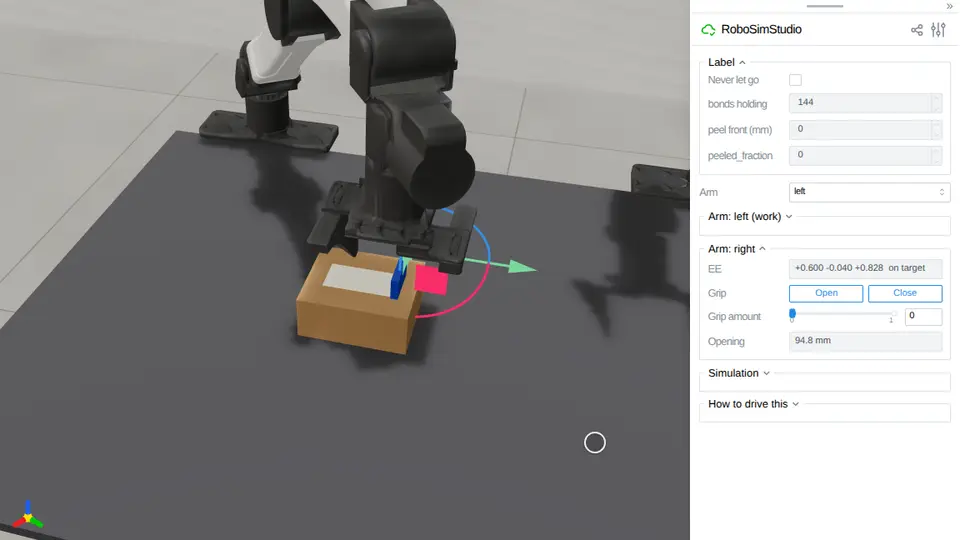
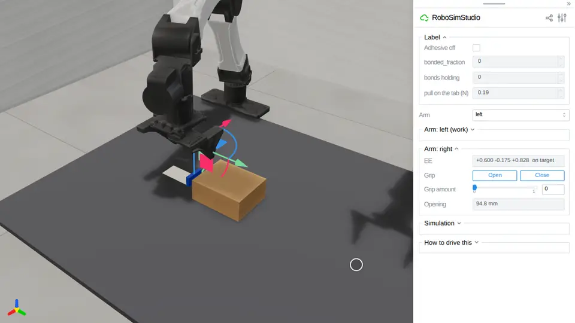

# Tape

A sheet stuck to a thing, that a hand peels off.
[`robosimstudio_materials/tape.py`](../../robosimstudio_materials/tape.py) is the
implementation behind `rss.tape`: a cloth held to a body by Newton 1.7's
particle-body attachments, one per particle, and a bond lets go once the sheet
has lifted off the body past `break_opening`, so a peel front travels along it as
it is pulled. Newton's attachments have no strength of their own; the break is the
kind's stated model, a kernel that switches an attachment off inside the captured
graph. The sheet's end is turned up into a rigid pull tab, the part a hand closes
on. One material ships, `rss.tapes.PAPER_LABEL`, and `peeled_fraction` reads how
much has let go. The body must be a free one on the tape's solver, which
`rss.TAPE_60HZ` arranges.

<!-- examples:start: written by scripts/example_readmes.py from each script's docstring -->

## Peel a label



A paper label stuck on a box, its end in a blue pull tab under the right hand: drag the hand down until its open jaws straddle the tab, press **Close**, drag it up 30 mm, then back toward the arm 20 mm and up 10 mm, seven times, and the label peels off the box row by row.

The grasp is contact: the pads squeeze the tab and nothing pins it to the hand. The label is a cloth
held to the box by Newton 1.7 particle-body attachments, one per particle, and a bond lets go once the
label has lifted 1 mm off the box, so the peel front travels with the hand. In eight drives all 144
bonds let go, the tab stayed within 3.6 mm of where the pads took it and the free box moved 1.7 mm at
most (`m10_screen.py`, `tests/test_peel_a_label`). Tick **Never let go** and no bond lets go: the
pull drags the box until the tab slides out of the pads (13 drives of 14), or, where the pads hold,
drags the whole box 45 mm by its label (`never_dist.py`). The tab is rigid, because the pads cannot
hold a cloth tab under the coupling the attachments need, and weighs 30 g, squeezed with 12 N: a 10 g
tab at 8 N slid out of the pads in one drive of seven (`robosimstudio_materials/tape.py`). The
**Label** folder reads `peeled_fraction` and the peel front. 38 ms a control step through the page
(RTX PRO 6000).

```bash
uv run examples/19_tape/00_peel_a_label.py
```

Source: [`00_peel_a_label.py`](00_peel_a_label.py)

## Peel a label, scored

The same box and label as a task document, with a goal on the share of the label's bonds that have let go: turn the right hand to point down, take the tab and peel as in `00_peel_a_label`, and the goal turns true at 80%.

The label is a `Tape.from_spec` record and the box a `Body.from_spec` one, placed by the
document under the names the label's `on` and the goal use, and the physics is
`rss.TAPE_60HZ` under a task-language name. The staging states the stiffer finger servo the
pinch needs. The hands start at the YAM's home, pointing ahead, so turn the right gizmo down
first. `tests/test_peel_a_label_scored` drives the right hand through the page and `evaluate`
says success.

```bash
uv run examples/19_tape/01_peel_a_label_scored.py
```

Source: [`01_peel_a_label_scored.py`](01_peel_a_label_scored.py)

## Stick a label



A loose paper label lies on the bench beside a box, its end in a blue pull tab under the right hand: set **Grip amount** to 0.6, drag the hand down onto the tab and press **Close**; drag it up, over the box's far end and down toward its near end, and the label lies down; set the grip back to 0.6 and lift the hand. Then press **Close** and rub the shut fingertips along the label, four strokes 10 mm apart: it sticks where they pressed, and **bonded_fraction** passes 0.8.

The label carries ipc-toolkit's adhesion law (`rss.tapes.LABEL`, `robosimstudio_materials/tape.py`):
a bond forms where the sheet is pressed onto the box harder than 8 kPa, pulls hardest, 4 kPa, at a
0.5 mm lift and lets go at 1 mm. The grasp is contact, the pads on the rigid tab. In five drives the
laid label held 1-6 of its 126 bonds, the four strokes 88-92%, and the tab drawn straight up 120 mm
peeled all but 1-2 bonds at 2.2-2.4 N on **pull on the tab**, the box moving 0.6 mm at most; with **Adhesive
off** the strokes made no bond (`tests/test_stick_a_label`). Rub lightly, the gizmo 3 mm under the
label: at 5 mm the fingertips dragged it along in two drives of three. 35 ms a control step (RTX PRO 6000).

```bash
uv run examples/19_tape/02_stick_a_label.py
```

Source: [`02_stick_a_label.py`](02_stick_a_label.py)

<!-- examples:end -->
