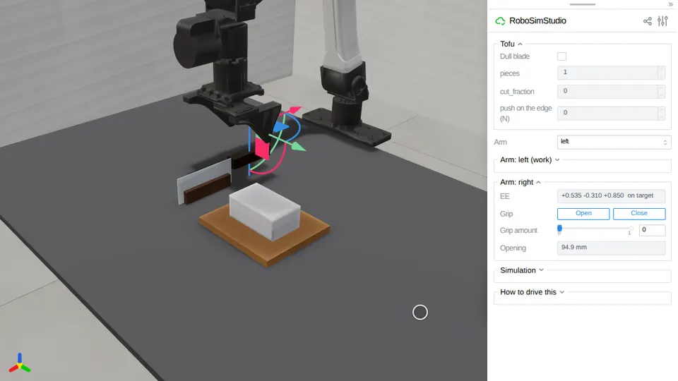

# Cutting

A block a knife parts in two.
[`robosimstudio_materials/cutting/`](../../robosimstudio_materials/cutting/__init__.py) is the
implementation behind `rss.cuttable` and `rss.knife`: the block is an elastic body on a cage, from the
walk-on-spheres cage cutter of Saeed et al. (SIGGRAPH 2026, MIT), vendored in
[`cagecut/`](../../robosimstudio_materials/cutting/cagecut/__init__.py), and the knife is a rigid body
on the arm's solver whose edge is a `blade` feature. The paper's solver has no contact, so the kind
states its own: the board holds the block's base, and an edge law pushes back on the knife and lets
the cut run once the push reaches the blade's threshold, the material's toughness over the knife's
sharpness. Three materials ship, `rss.cuttables.TOFU`, `CAKE` and `FOAM`, with sourced constants;
`pieces` and `cut_fraction` read the cut. `rss.CUTTING_50HZ` puts the arm and the knife on one solver,
so the pads hold the handle by friction.

<!-- examples:start: written by scripts/example_readmes.py from each script's docstring -->

## Cut tofu



A block of firm tofu on a cutting board, and a kitchen knife standing on its edge in a rest under the right hand: drag the hand down onto the knife's handle, press **Close**, drag it up 70 mm, across to the tofu and down until the edge meets the board, and the tofu parts in two.

The grasp is contact: the pads close on the 20 mm handle at 20.4 mm and nothing pins it to the hand.
The tofu is a cage on the vendored walk-on-spheres cutter, its base held by the board; the cut starts
in the blade's plane, runs where the edge pushes past the blade's threshold (0.18 N across 60 mm of
tofu), and the knife feels that push. In three drives through the arm panel (`tests/test_cut_tofu`)
the tofu read 2 `pieces` with the edge on the board, and 1 piece, cut 88% through, with the hand
stopped 15 mm higher. Tick **Dull blade**, a blade a thousand times duller, and push the same way: the
push swings from step to step, up to 17-20 N on the way down and 3-15 N with the hand held low; the
knife tips 16-17 degrees in the pads and the arm stalls with the edge's lowest point 7-9 mm into the
tofu, which stays whole (the test's drive and one without its pause, twice each). 13 ms a control
step cutting through the page, 9 ms idle (RTX PRO 6000).

```bash
uv run examples/20_cutting/00_cut_tofu.py
```

Source: [`00_cut_tofu.py`](00_cut_tofu.py)

## Cut tofu, scored

The same knife, rest, board and tofu as a task document, with a goal that the tofu is in two pieces: take the knife and push it down through the tofu as in `00_cut_tofu`, and the goal turns true.

The tofu is a `Cuttable.from_spec` record, the knife a `Cuttable.knife` one carrying its edge as a
`blade` feature, and the rest and the board are fixtures. The embodiment is the YAM with
`00_cut_tofu`'s right-arm home, the hand over the handle, and the physics `rss.CUTTING_50HZ`
under a task-language name. Before the hand comes the goal is unmet; `tests/test_cut_tofu_scored`
drives the cut through the page and `evaluate` reads `pieces` 2 and says success.

```bash
uv run examples/20_cutting/01_cut_tofu_scored.py
```

Source: [`01_cut_tofu_scored.py`](01_cut_tofu_scored.py)

<!-- examples:end -->
