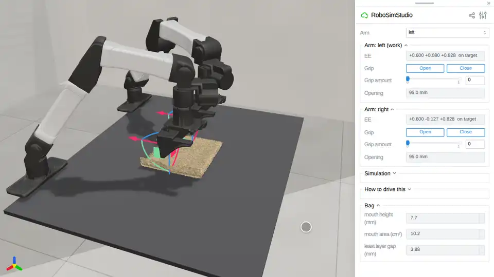

# Examples

## [00 Getting Started](00_getting_started/README.md)

| [Hello world](00_getting_started/00_hello_world.py) | [Core concepts](00_getting_started/01_core_concepts.py) |
|---|---|
|  |  |

## [01 Cloth Simulation](01_cloth/README.md)

| [Towel](01_cloth/00_towel.py) | [Fabrics](01_cloth/01_fabrics.py) | [Other engines](01_cloth/02_engines.py) |
|---|---|---|
|  |  |  |

## [02 Soft-Body Simulation](02_soft/README.md)

| [Sponge](02_soft/00_sponge.py) | [Tet mesh](02_soft/01_tet_mesh.py) | [Your own](02_soft/02_your_own_soft.py) |
|---|---|---|
|  |  |  |

## [03 Rope Simulation](03_rope/README.md)

| [Cable](03_rope/00_cable.py) | [Between posts](03_rope/01_between_posts.py) | [SuperDex](03_rope/02_superdex.py) |
|---|---|---|
|  |  |  |

| [A cable keeps its bend](03_rope/03_cable_memory.py) | [A cable carries a twist](03_rope/04_twist.py) |
|---|---|

## [04 Robots and Kinds of Your Own](04_extending/README.md)

| [Add a robot](04_extending/00_add_a_robot.py) | [A new kind](04_extending/01_new_kind.py) |
|---|---|
|  |  |

## [05 The Browser Studio](05_studio/README.md)

| [Your own panel](05_studio/00_your_own_panel.py) | [Render](05_studio/01_render.py) |
|---|---|
|  |  |

## [06 Tasks and Scoring](06_tasks/README.md)

| [First task](06_tasks/00_your_first_task.py) | [Goals and rewards](06_tasks/01_goals_and_rewards.py) | [Episodes](06_tasks/02_episodes.py) |
|---|---|---|
|  |  |  |

## [07 Policies as Graphs](07_policies/README.md)

| [Pick and place](07_policies/00_pick_and_place.py) | [Check and retry](07_policies/01_check_and_retry.py) | [Many worlds](07_policies/03_many_worlds.py) |
|---|---|---|
|  |  |  |

## [08 Demos](08_demos/README.md)

| [Wipe the bar](08_demos/wipe_the_bar/wipe_the_bar.py) | [Route the cable](08_demos/route_the_cable/route_the_cable.py) | [Fold the towel](08_demos/fold_the_towel/fold_the_towel.py) |
|---|---|---|
|  |  |  |

## [09 Teleoperation](09_teleop/README.md)

| [Leader arm](09_teleop/00_leader_arm.py) | [Force feedback](09_teleop/01_force_feedback.py) |
|---|---|
|  |  |

## [10 Granular](10_granular/README.md)

| [Sweep rice into the tray](10_granular/00_sweep_rice.py) | [Sweep rice, scored](10_granular/01_sweep_rice_scored.py) |
|---|---|

## [11 Liquid](11_liquid/README.md)

| [Pour honey into a bowl](11_liquid/00_pour_honey.py) | [Wipe a spill](11_liquid/01_wipe_spill.py) |
|---|---|

## [12 Dough](12_dough/README.md)

| [Roll the dough flat](12_dough/00_roll_dough.py) | [Press a dough ball](12_dough/01_press_dough.py) |
|---|---|

## [13 Paper](13_paper/README.md)

| [Fold a sheet of paper](13_paper/00_fold_paper.py) | [Close a cardboard flap](13_paper/01_box_flap.py) |
|---|---|

## [16 Bags](16_bags/README.md)

| [Open a bag](16_bags/00_open_a_bag.py) | [Open a bag, scored](16_bags/01_open_a_bag_scored.py) |
|---|---|
|  | |

## [Live Scene Editing](live/README.md)

| [The live page](live/README.md) |
|---|
|  |

## Running them

Run one by path from the repository root; all but the headless render open the
studio in your browser:

```bash
uv run examples/01_cloth/00_towel.py
```

No script takes a flag (except `09_teleop/`, which takes the leader arm's port
and calibration); edit the locals at the top of `main()`. Folders are numbered
in reading order.
